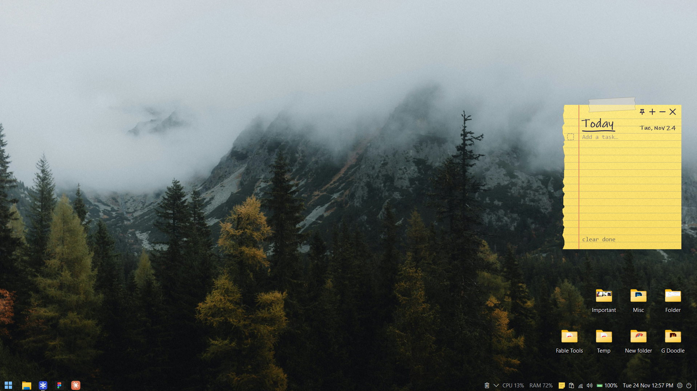
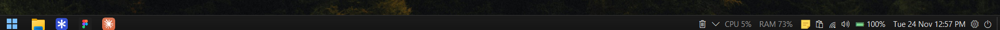
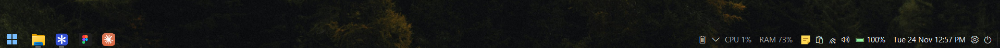
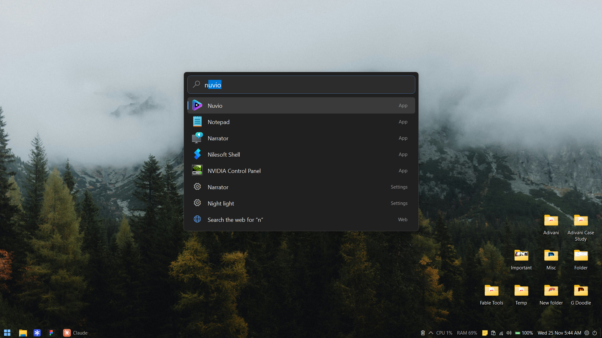
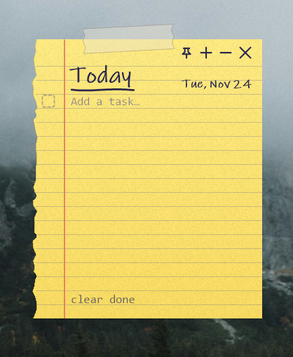

<p align="center">
  
</p>

<h1 align="center">Fable Thin Bar</h1>

<p align="center">A thin, minimal taskbar for Windows 11 and 10, in a single PowerShell script.<br>
No installer and no third-party software: it builds a small app with the C# compiler that already ships with Windows.</p>

---



## Features

- **Thin 28 px bar** that replaces the built-in taskbar (the real one is hidden, not removed).
- **Solid, translucent or transparent** look: right-click an empty part of the bar to switch.
- **Sticky-note widget**: cream paper notes with a paperclip, on the desktop, with tasks and plain text, word wrap, colours, keep-on-top, minimise and delete.
- **Clipboard** button that opens Windows clipboard history (Win+V).
- **CPU and RAM usage** right on the bar; click it to open **Task Manager**.
- **On/off options**: turn the CPU and RAM readout on or off, and exit the bar from its right-click menu.
- **Very low memory use**: no background services, a lightweight CPU reading instead of performance counters, cached icons, and unused memory is handed back to Windows.
- **Pinned apps and open windows** with live hover previews, drag to reorder, and pinning from the Start menu.
- **Free up memory** (bolt icon): lists the apps using the most RAM; tick the ones you don't need and close them in one click. Windows itself and security tools are never listed.
- **Drag and drop** files onto apps to open them, or onto the **recycle bin** icon to delete them.
- **Quick search (Win+Space)**: a search box in the middle of the screen for installed apps and Settings pages, with auto-fill as you type.
- **Web search and pins in search**: every search ends with "Search the web" (or "Open site" for an address), which opens in your default browser. Right-click a result (or press Ctrl+P) to pin it: pinned items appear as soon as the box opens and rank first; apps can also be pinned to the taskbar from there.
- **Your own search items**: anything you put in `Documents\Thinbar Search` (files, folders, shortcuts, websites) shows up in search, listed first.
- **Tray**: hidden-icons popup, Wi-Fi, volume, battery, clock, Settings and a power menu (Lock, Restart, Shut down).

## Screenshots

**Solid**



**Transparent**


**Win+Space search**


<p>
  
</p>

## Install

1. Download [`FableThinBar.ps1`](FableThinBar.ps1) (open it, then **Download raw file**).
2. In the folder you saved it to, hold **Shift**, right-click an empty spot and choose **Open in Terminal** (or **Open PowerShell window here**).
3. Run:

   ```powershell
   powershell -ExecutionPolicy Bypass -File .\FableThinBar.ps1
   ```

The screen flickers once while Explorer restarts, then the bar appears. It starts automatically at every sign-in.

## Remove

```powershell
powershell -ExecutionPolicy Bypass -File .\FableThinBar.ps1 -Uninstall
```

This stops the bar, removes auto-start and the app folder (including your pins and sticky notes), and brings the normal taskbar back. You can also right-click the bar and choose **Exit Fable Thin Bar** to close it until the next sign-in.

## Good to know

- **Where things live:** the app, your pins, notes and settings are in `%LOCALAPPDATA%\FableThinBar`. If something goes wrong, `error.log` in that folder says what happened.
- **Unsigned code:** the script compiles the app on your PC, so it is not code-signed. Windows SmartScreen or antivirus may ask about it. Read the script first if you want to see exactly what it does.
- **Undocumented Windows features:** the translucent/transparent modes and the hidden-icons popup rely on behaviour Windows doesn't officially document, so a Windows update can break them. Switch back to **Solid** if the bar looks wrong.
- **Store apps** (Calculator, Settings, the new Notepad) can't be pinned.
- **One monitor:** the bar shows on the primary screen only.

## Requirements

Windows 10 or 11 (64-bit) with .NET Framework 4.x, which every current Windows install already has.

## Licence

[MIT](LICENSE). Not affiliated with Microsoft.
